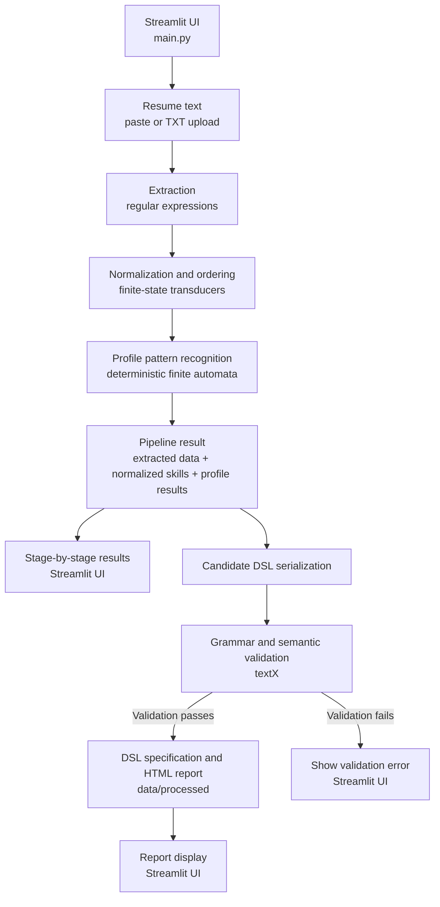

pone esto en lo de arquitectura: # ResumeLens Architecture

## 1. Purpose and scope

ResumeLens extracts selected information and technical qualifications from resume text, converts recognized qualifications to canonical identifiers, and checks those identifiers against formal patterns for professional profiles. The application provides a step-by-step view of the results and can generate a validated candidate-profile document and HTML report.

The profile result is a rule-based pattern match, not a general assessment of a candidate's ability or suitability. The application does not rank candidates or make hiring decisions.

## 2. System overview

The application is a Streamlit interface backed by a Python processing pipeline. The first three stages run in `src.pipeline`; the final DSL validation and report generation are initiated by the results view in `main.py`.



The processing path is sequential: extraction feeds normalization, which feeds profile recognition. The pipeline returns the accumulated results together; the UI displays those results after processing. The separate DSL branch then validates that same pipeline result. If validation succeeds, the DSL specification and HTML report are written and the report is displayed. If validation fails, the UI shows the syntax or semantic validation error and no report is generated. These display and report branches do not mean that an earlier processing stage is skipped.

## 3. Components

### 3.1. User interface — `main.py`

The Streamlit application accepts pasted resume text or an uploaded plain-text (`.txt`) file and lets the user choose a profile. It displays extraction, normalization, recognition, and validation results in separate tabs.

The selected profile controls the ordering of the displayed normalized qualifications and the selected classification result. The pipeline also evaluates every supported profile and presents those results together.

### 3.2. Extraction — `src/extraction/regex_extractor.py`

`stage_1_extract_resume_data` uses Python regular expressions to extract candidate name, contact details, education details, experience text and years, and technical qualifications. It also groups recognized qualifications into categories such as languages, frameworks, databases, machine-learning libraries, and tools.

Extraction is rule-based and limited to the patterns defined in the module; it is not a general-purpose resume parser. `src/extraction/reader.py` separately provides a utility for loading `.txt` and, when the optional `pypdf` package is installed, `.pdf` files from a directory. The current Streamlit interface accepts `.txt` uploads only.

### 3.3. Normalization and ordering — `src/normalization/`

`fst_normalizer.py` defines `pyformlang` finite-state transducers that map supported spellings and aliases to canonical uppercase identifiers, for example `Node.js` to `NODE_JS`. Unknown qualifications are excluded from the normalized sequence.

`canonical_sorter.py` removes duplicate canonical values and orders the recognized values according to the selected profile's expected sequence. This ordered sequence is supplied to the recognizer and shown in the UI.

### 3.4. Profile pattern recognition — `src/classification/profile_automata.py`

The module defines deterministic finite automata with ordered stages and alternatives within selected stages. Each evaluation returns `ACCEPTED` or `REJECTED`; it is based on the recognized canonical qualification sequence, not on a score or a comparison between candidates. Unsupported tokens, extra qualifications, or an incorrect order can cause rejection.

The four evaluated patterns are Full Stack, Machine Learning Engineer, DevOps Engineer, and Data Engineer. Profile patterns and their required stages are defined centrally and share the same evaluation logic.

### 3.5. Candidate DSL and validation — `src/dsl/`

`specification.py` serializes the pipeline result into the candidate DSL defined in `candidate_dsl.tx`. It includes candidate contact details, optional experience entries, normalized skills, and evaluations for all four profiles.

`validator.py` builds a textX metamodel, parses the DSL, and applies semantic checks. These checks include a non-empty candidate name, valid email and phone values, at least one normalized skill, unique skills, non-negative experience years, and exactly one classification for each supported profile. The experience section itself is optional.

The module also supports the legacy grammar in `resume_grammar.tx`. The current pipeline-to-report flow uses the newer candidate DSL.

### 3.6. Report generation — `src/dsl/visualizer.py`

After successful validation, `generate_candidate_profile` writes the candidate DSL specification and an HTML report to the requested output directory. `main.py` requests this output under `data/processed` and displays the HTML report in the validation tab. Markdown report generation is also available in the visualizer module, but is not part of the current UI flow.

## 4. Runtime flow

1. The user pastes resume text or uploads a `.txt` file and selects a target profile.
2. `process_resume_pipeline` calls the extraction stage to produce candidate details and raw qualifications.
3. The pipeline normalizes the qualifications and orders them for the selected profile.
4. The pipeline evaluates the qualifications against all four profile automata and records the selected profile's result.
5. The UI displays the extracted information, normalized qualifications, and profile results.
6. The validation view serializes the result as candidate DSL, parses and semantically validates it, writes the DSL and HTML report to `data/processed`, and displays the report.

If DSL syntax or semantic validation fails, the validation view reports the error rather than displaying a successful report.

## 5. Project layout

```text
JMapostles/
├── main.py
├── src/
│   ├── pipeline.py
│   ├── extraction/
│   │   ├── reader.py
│   │   └── regex_extractor.py
│   ├── normalization/
│   │   ├── canonical_sorter.py
│   │   └── fst_normalizer.py
│   ├── classification/
│   │   └── profile_automata.py
│   └── dsl/
│       ├── candidate_dsl.tx
│       ├── resume_grammar.tx
│       ├── specification.py
│       ├── validator.py
│       └── visualizer.py
├── tests/
├── data/
│   └── processed/
├── docs/
│   └── architecture.md
└── requirements.txt
```

The tests cover the extraction, normalization, classification, pipeline, DSL validation, and report-generation stages.

## 6. Data passed between stages

| Stage | Input | Output |
|---|---|---|
| Extraction | Raw resume text | Candidate/contact details, experience and education data, categorized qualifications, and extracted qualifications |
| Normalization | Extracted qualifications and selected profile | Unique canonical qualification identifiers ordered for that profile |
| Recognition | Canonical qualifications and each profile's automaton | `ACCEPTED` or `REJECTED` result for each profile |
| DSL serialization | Pipeline result | Candidate-profile DSL text |
| Validation | DSL text and textX grammar | Parsed profile or syntax/semantic validation error |
| Report generation | Validated profile | DSL specification file and HTML report |

## 7. Supported profile names

The recognition module's canonical profile keys are `FULL_STACK`, `ML_ENGINEER`, `DEVOPS_ENGINEER`, and `DATA_ENGINEER`. The UI displays these as Full Stack Developer, Machine Learning Engineer, DevOps Engineer, and Data Engineer.

There is a naming compatibility discrepancy in the current implementation: the DSL serializer maps `DEVOPS_ENGINEER` to `SOFTWARE_ENGINEER`, and the DSL grammar requires `SOFTWARE_ENGINEER` as one of its four classification names. This affects the serialized DSL/report label; it does not change the DevOps automaton used for recognition. The mapping should be aligned across the UI, evaluator, serializer, and grammar if the profile is renamed in a future change.

## 8. Testing and design constraints

The test suite exercises each processing stage as well as the end-to-end pipeline and DSL/report flow. It includes recognized and unrecognized sequences, canonicalization of aliases, order-sensitive profile patterns, validation failures, and all four supported profile patterns.

The design keeps extraction, normalization, recognition, validation, and presentation as distinct responsibilities. Profile rules remain data-driven through shared evaluation logic, while the user-facing results remain traceable to extracted qualifications and formal pattern checks.