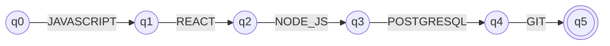
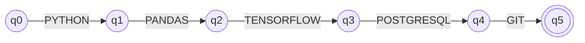
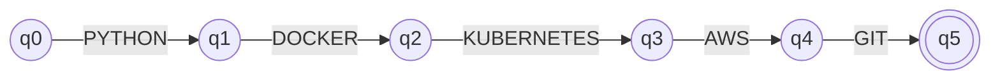
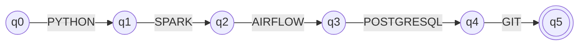

# Stage 3 — Qualification Pattern Recognition with Finite Automata

## Objective and interface

Stage 3 receives the ordered canonical qualification tokens produced by Stage
2. It checks whether the complete sequence matches one of the four
professional-profile patterns. It does not extract or normalize text.

The implementation in `src/classification/profile_automata.py` uses
`pyformlang.finite_automaton.DeterministicFiniteAutomaton` (DFA). The public
functions `evaluate_full_stack`, `evaluate_ml_engineer`,
`evaluate_devops_engineer`, and `evaluate_data_engineer` return `ACCEPTED` or
`REJECTED`. `evaluate_all_profiles` returns that result for each profile.
`evaluate_profile` accepts profile names such as `FULL_STACK` and
`Machine Learning Engineer`; unsupported names raise `ValueError`.

The pipeline sorts the extracted and normalized qualifications for the
selected profile, then returns both the selected `classification` and
`profile_results` in addition to the extraction and normalized data.

## Profile patterns

The accepted words, using canonical qualification tokens as alphabet symbols,
are:

| Profile | Accepted sequence |
|---|---|
| `FULL_STACK` | `JAVASCRIPT REACT NODE_JS POSTGRESQL GIT` |
| `ML_ENGINEER` | `PYTHON PANDAS TENSORFLOW POSTGRESQL GIT` |
| `DEVOPS_ENGINEER` | `PYTHON DOCKER KUBERNETES AWS GIT` |
| `DATA_ENGINEER` | `PYTHON SPARK AIRFLOW POSTGRESQL GIT` |

These patterns are intentionally exact and order-sensitive. A permutation,
missing token, extra token, unknown token, or empty sequence is rejected.

## Formal DFA definition

For each profile `p`, the automaton is a complete deterministic 5-tuple:

`M_p = (Q_p, Σ, δ_p, q0, F_p)`

- `Q_p = {q0, q1, q2, q3, q4, q5, q_reject}`.
- `Σ` is the set of canonical qualification tokens from Stage 2, i.e.
  `{JAVASCRIPT, TYPESCRIPT, REACT, NODE_JS, POSTGRESQL, MYSQL, MONGODB,
  SQLITE, SQL, PYTHON, PANDAS, NUMPY, SCIKIT_LEARN, TENSORFLOW, PYTORCH,
  GIT, GITHUB, GITHUB_ACTIONS, DOCKER, KUBERNETES, AWS, TERRAFORM, JENKINS,
  SPARK, SNOWFLAKE, AIRFLOW, KAFKA}`.
- Let the accepted sequence for profile `p` be
  `w_p = a1 a2 a3 a4 a5`. For `0 ≤ i < 5`, `δ_p(q_i, a_(i+1)) = q_(i+1)`.
  Every other symbol from a state `q_i` goes to `q_reject`; every symbol
  from `q5` also goes to `q_reject`; and `δ_p(q_reject, a) = q_reject` for
  every `a ∈ Σ`.
- Initial state: `q0`.
- `F_p = {q5}`.

This defines a complete DFA: every state has exactly one transition for every
symbol in `Σ`. Since the automaton has no output relation and no epsilon
transitions, it is a DFA, not an NFA or epsilon-NFA.

### Full Stack Developer

`w_FULL_STACK = JAVASCRIPT REACT NODE_JS POSTGRESQL GIT`



### Machine Learning Engineer

`w_ML_ENGINEER = PYTHON PANDAS TENSORFLOW POSTGRESQL GIT`



### DevOps Engineer

`w_DEVOPS_ENGINEER = PYTHON DOCKER KUBERNETES AWS GIT`



### Data Engineer

`w_DATA_ENGINEER = PYTHON SPARK AIRFLOW POSTGRESQL GIT`



In each diagram, `q5` is the only accepting state. For readability, the
diagrams show the accepting path only. The other transitions required for the
complete DFA go to `q_reject`, which has a self-loop for every symbol in
`Σ`.

## Examples

```text
[PYTHON, PANDAS, TENSORFLOW, POSTGRESQL, GIT]
  under ML_ENGINEER -> ACCEPTED

[PYTHON, POSTGRESQL, GIT]
  under ML_ENGINEER -> REJECTED (missing required tokens)

[REACT, JAVASCRIPT, NODE_JS, POSTGRESQL, GIT]
  under FULL_STACK -> REJECTED (wrong order)
```
